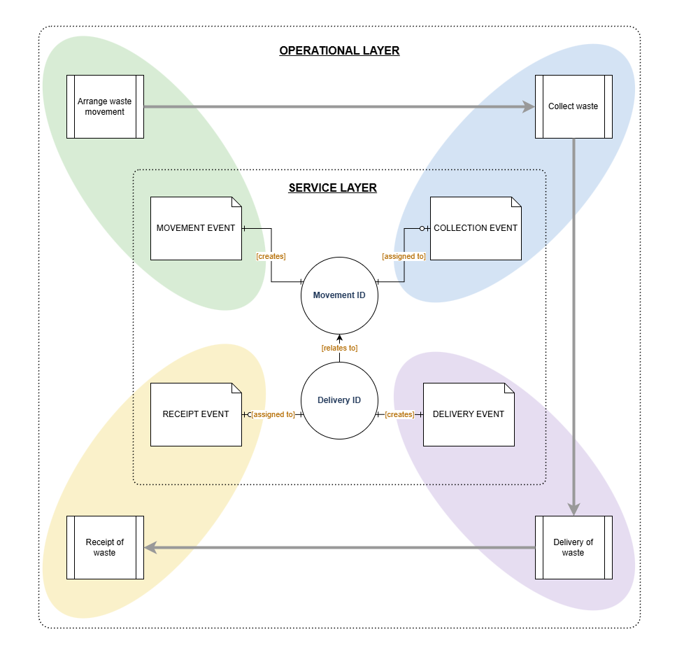

# Digital Waste Tracking: API integration guidance

**Status:** draft outline, v1.0

**Owner:** Dave Oliver

## Contents

- [1. Introduction](#1-introduction)
- [2. Service overview](#2-service-overview)
  - [2.1 Lifecycle stages](#21-lifecycle-stages)
  - [2.2 Actors](#22-actors)
  - [2.3 Core identifiers](#23-core-identifiers)
- [3. API reference](#3-api-reference)
- [4. Business rules and data reconciliation](#4-business-rules-and-data-reconciliation)
  - [4.1 Collection cardinality](#41-collection-cardinality)
  - [4.2 Movement-to-delivery cardinality](#42-movement-to-delivery-cardinality)
- [Appendix A: glossary](#appendix-a-glossary)
- [Appendix B: endpoint quick reference](#appendix-b-endpoint-quick-reference)

---

## 1. Introduction

This document provides guidance for software providers building producer, broker, carrier/driver or receiver-facing systems that will interact with Defra's dedicated API to record waste movements.

 

## 2. Service overview

{ width="600" }

### 2.1 Lifecycle stages

The API is organised around four stages:

| Stage | What happens |
| --- | --- |
| Creation | Movement created; estimated details declared; Movement ID generated |
| Collection | Carrier/driver records the collection against a Movement ID |
| Delivery | Driver records delivery and declares the Movement ID in scope; Delivery ID generated |
| Receipt | Receiving site records acceptance of the waste against the Delivery ID |

### 2.2 Actors

- **Producer / Controller (EA term)** – the organisation whose waste is being moved
- **Broker / Controller (EA term)** – arranges the movement on behalf of a producer or receiver
- **Carrier / Transporter (EA term)** – the organisation licensed to transport the waste; may operate through a **Driver** as the field-level user recording events in real time
- **Receiver** – the site accepting the waste for treatment, disposal or recovery

### 2.3 Core identifiers

- **Waste Movement ID** – `movementId` is the primary record of an intended waste movement, created before the waste moves
- **Waste Delivery ID** – `deliveryId` is the record created at delivery; a single Delivery ID can bundle one or more Movement IDs together

 

## 3. API reference

You can see the current API spec at: [Digital Waste Tracking OpenAPI specification](api/openapi-beta-1.md).

The spec will update with each milestone in the development process – expect some shapes to shift before go-live.

 

## 4. Business rules and data reconciliation

### 4.1 Collection cardinality

One collection entry per physical collection event, even where loads are later combined at delivery.

### 4.2 Movement-to-delivery cardinality

Many Movement IDs can be linked to a single Delivery ID at delivery; a Delivery ID always originates from exactly one delivery event.

 

## Appendix A: glossary

| Term | Meaning |
| --- | --- |
| **DWT** | Digital Waste Tracking – the digital service this API supports |
| **EA** | Environment Agency |
| **EWC** | European Waste Catalogue – the code list used to classify waste type |
| **HWCN** | Hazardous Waste Consignment Note – the paper record DWT replaces for hazardous waste |
| **POPs** | Persistent organic pollutants – chemicals subject to additional handling and reporting rules |
| **Waste Movement ID** | Identifier issued when a movement is created, before waste moves |
| **Waste Delivery ID** | Identifier issued at delivery; can link multiple Movement IDs together |
| **WTN** | Waste Transfer Note – the paper record DWT replaces for non-hazardous waste |

## Appendix B: endpoint quick reference

| Method   | Path                                 |
| -------- | ------------------------------------ |
| **POST** | `/movements`                         |
| **POST** | `/movements/{movementId}/collection` |
| **POST** | `/deliveries`                        |
| **POST** | `/deliveries/{deliveryId}/receipt`   |
